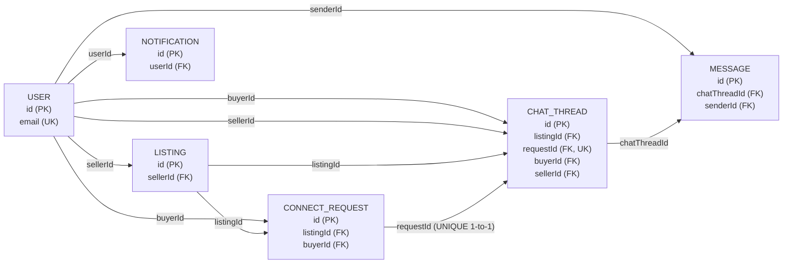

# PlanBDeal — Database Schema Visual Guide

Source of truth: [`server/prisma/schema.prisma`](server/prisma/schema.prisma). Six tables, all connected through simple foreign keys.

---

## Table boxes connected by lines (key names labeled on each line)



Each box is a table, showing only its keys. Each line is labeled with the **actual foreign-key column name** that creates that connection — e.g. the line into LISTING is labeled `sellerId` because `Listing.sellerId` is the column pointing back to `User.id`. The line between CONNECT_REQUEST and CHAT_THREAD is marked "UNIQUE 1-to-1" because `ChatThread.requestId` has `@unique` in the schema, making that the one strict one-to-one relationship — every other line is one-to-many.

---

## Entity-Relationship Diagram (with full column lists)

```mermaid
erDiagram
    USER ||--o{ LISTING : "sells (sellerId)"
    USER ||--o{ CONNECT_REQUEST : "requests (buyerId)"
    USER ||--o{ CHAT_THREAD : "buyer in (buyerId)"
    USER ||--o{ CHAT_THREAD : "seller in (sellerId)"
    USER ||--o{ MESSAGE : "sends (senderId)"
    USER ||--o{ NOTIFICATION : "receives (userId)"

    LISTING ||--o{ CONNECT_REQUEST : "receives (listingId)"
    LISTING ||--o{ CHAT_THREAD : "linked to (listingId)"

    CONNECT_REQUEST ||--|| CHAT_THREAD : "unlocks (requestId, UNIQUE)"

    CHAT_THREAD ||--o{ MESSAGE : "contains (chatThreadId)"

    USER {
        string id PK
        string fullName
        string email UK
        string passwordHash
        datetime createdAt
        datetime updatedAt
    }

    LISTING {
        string id PK
        string sellerId FK
        string movieTitle
        string city
        datetime showDateTime
        int totalQuantity
        int availableQuantity
        decimal originalPricePerTicket
        decimal askingPricePerTicket
        enum status
        enum transferMethod
    }

    CONNECT_REQUEST {
        string id PK
        string listingId FK
        string buyerId FK
        int quantity
        string message
        enum status
    }

    CHAT_THREAD {
        string id PK
        string listingId FK
        string requestId FK_UK
        string buyerId FK
        string sellerId FK
    }

    MESSAGE {
        string id PK
        string chatThreadId FK
        string senderId FK
        string content
        datetime readAt
    }

    NOTIFICATION {
        string id PK
        string userId FK
        enum type
        string title
        string message
        string relatedListingId
        string relatedRequestId
        string relatedChatThreadId
    }
```

**Legend:** `PK` = primary key · `FK` = foreign key · `UK` = unique key · `FK_UK` = foreign key that is *also* unique (this is what makes ConnectRequest ↔ ChatThread a strict 1-to-1 instead of 1-to-many).

---

## How to read the diagram

- **`||--o{`** means "one of these, many of those" (1-to-many). Example: `USER ||--o{ LISTING` = one User can have many Listings.
- **`||--||`** means "exactly one on both sides" (1-to-1). Only one relationship in this schema is 1-to-1: `CONNECT_REQUEST ||--|| CHAT_THREAD` — enforced because `ChatThread.requestId` has `@unique` in the Prisma schema, so the database physically cannot store two ChatThreads for the same ConnectRequest.
- Every arrow is backed by a **real foreign key column** shown in parentheses — e.g. `Listing.sellerId` is the column that makes `USER ||--o{ LISTING` possible.
- `relatedListingId`, `relatedRequestId`, `relatedChatThreadId` on NOTIFICATION are **not drawn as relationships** on purpose — they're plain nullable string columns, not enforced foreign keys (confirmed in the schema: no `@relation` on them). They're just loose pointers used to build links in the UI.

---

## Table-by-table explanation

### USER
Everyone who signs up. Acts as either a buyer or a seller depending on context — there's no separate `role` column.
- **PK:** `id`
- **Unique:** `email`
- Referenced by: Listing, ConnectRequest, ChatThread (twice — buyer and seller), Message, Notification.

### LISTING
A ticket someone is selling.
- **PK:** `id`
- **FK:** `sellerId → User.id`
- `totalQuantity` is fixed at creation; `availableQuantity` decreases as requests get accepted (this is the column the concurrency-safe atomic update protects).
- `status` enum: `ACTIVE | SOLD | CANCELLED | EXPIRED`.

### CONNECT_REQUEST
A buyer's request for tickets from a listing.
- **PK:** `id`
- **FK:** `listingId → Listing.id`, `buyerId → User.id`
- `status` enum: `PENDING | ACCEPTED | REJECTED | WITHDRAWN`.
- Only the oldest `PENDING` request per listing is treated as "active" by the application (the FIFO queue logic) — this isn't a separate column, it's computed from `createdAt` ordering at query time.

### CHAT_THREAD
The conversation unlocked once a request is accepted.
- **PK:** `id`
- **FK:** `listingId → Listing.id`, `requestId → ConnectRequest.id` (**unique** — the 1-to-1 enforcement), `buyerId → User.id`, `sellerId → User.id`.
- Created exactly once, inside the same transaction that accepts the request.

### MESSAGE
One chat message inside a thread.
- **PK:** `id`
- **FK:** `chatThreadId → ChatThread.id`, `senderId → User.id`
- `readAt` is nullable — set when the recipient has seen it (currently tracked but not yet surfaced in the UI as read receipts).

### NOTIFICATION
An alert shown to a user.
- **PK:** `id`
- **FK:** `userId → User.id`
- `type` enum: `NEW_REQUEST | REQUEST_ACCEPTED | REQUEST_REJECTED | NEW_MESSAGE | LISTING_EXPIRED`
- The three `related*Id` columns are informational only (no DB-level constraint).

---

## Example data flow (traced through the diagram)

1. **Ravi** signs up → row in `USER`.
2. Ravi lists a ticket → row in `LISTING` with `sellerId = Ravi.id`.
3. **Priya** signs up → another row in `USER`.
4. Priya requests it → row in `CONNECT_REQUEST` with `listingId = <Ravi's listing>` and `buyerId = Priya.id`.
5. Ravi accepts → `CONNECT_REQUEST.status` becomes `ACCEPTED`, `LISTING.availableQuantity` decreases by 1, and a new `CHAT_THREAD` row is created with `requestId` pointing back to that exact request.
6. Both chat → rows in `MESSAGE`, each with `chatThreadId` pointing to that one thread.
7. Both get notified at various points → rows in `NOTIFICATION` with `userId` pointing to whichever of Ravi/Priya should see it.

---

## Indexes (for performance, not shown in the ER diagram above)

| Table | Index | Matches this query |
|---|---|---|
| Listing | `(city, movieTitle, showDateTime, status)` | Explore page search/filter |
| ConnectRequest | `(listingId, buyerId, status)` | FIFO queue lookups |
| Message | `(chatThreadId, createdAt)` | Paginated chat history |
| Notification | `(userId, readAt)` | "My unread notifications" |

Plus automatic unique indexes on `User.email` and `ChatThread.requestId`, and a primary-key index on every table's `id`.
